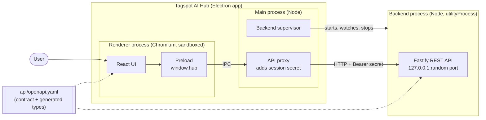
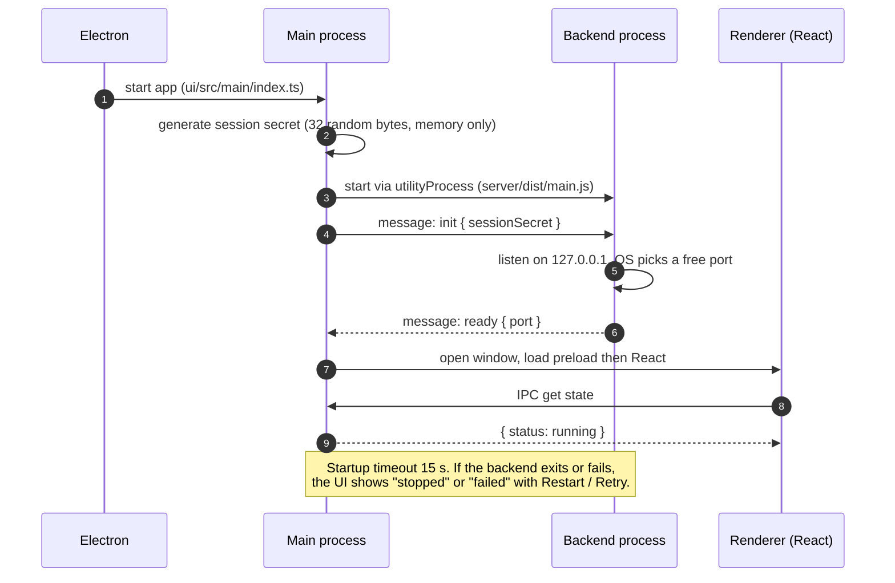
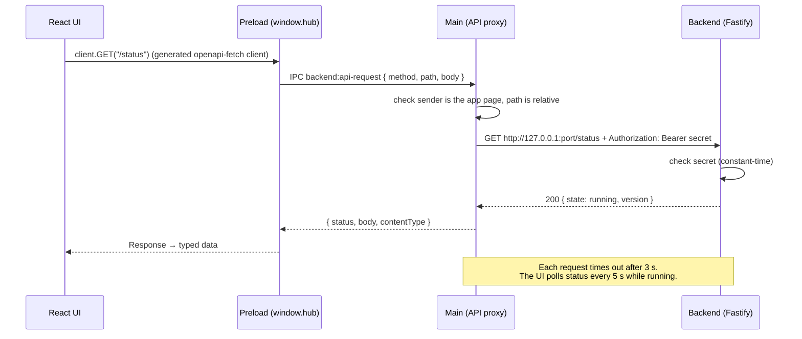

# Architecture

This document grows with the hub. Each OpenSpec change that alters the architecture
updates the diagrams below and adds a row to the [change log](#change-log).
Decisions behind it live in [`docs/adr/`](adr/); behavior lives in
[`openspec/specs/`](../openspec/specs/).

## Components

**Rules**

- The renderer never sees the backend's port or session secret. Every API call
  goes renderer → preload → IPC → main → backend.
- The backend listens on `127.0.0.1` only and rejects any request without the
  session secret.
- Main accepts IPC only from the app's own page; the window cannot navigate away
  or open new windows.
- The UI and backend share one contract: `api/openapi.yaml`.

## Startup

## Request flow (renderer → backend)

## Shutdown

- **User quits:** main stops the backend first (waits at most 5 s), then exits.
- **Backend crashes:** the UI shows "Backend stopped" with a Restart button.
- **App is killed:** the backend checks every 2 s that its parent is alive and
  exits on its own.

## Change log

| Change                    | Date       | Architecture impact                                                                                                                                                                                      |
| ------------------------- | ---------- | -------------------------------------------------------------------------------------------------------------------------------------------------------------------------------------------------------- |
| `setup-project-structure` | 2026-11-24 | First version: Electron main, sandboxed React renderer, Node/Fastify backend in a `utilityProcess`, session secret, API calls proxied through main ([ADR 12](adr/0012-node-backend-separate-process.md)) |
